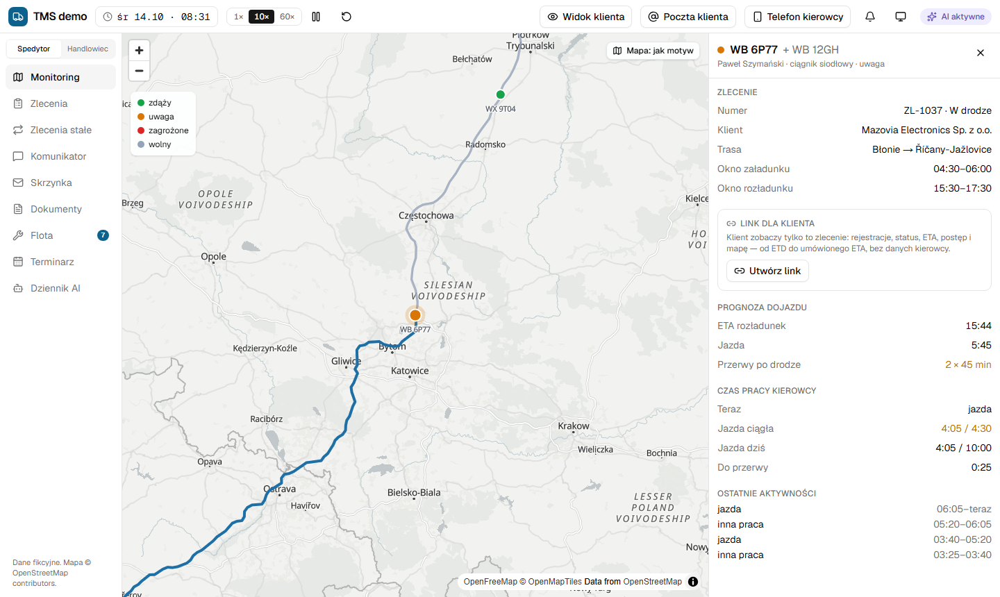
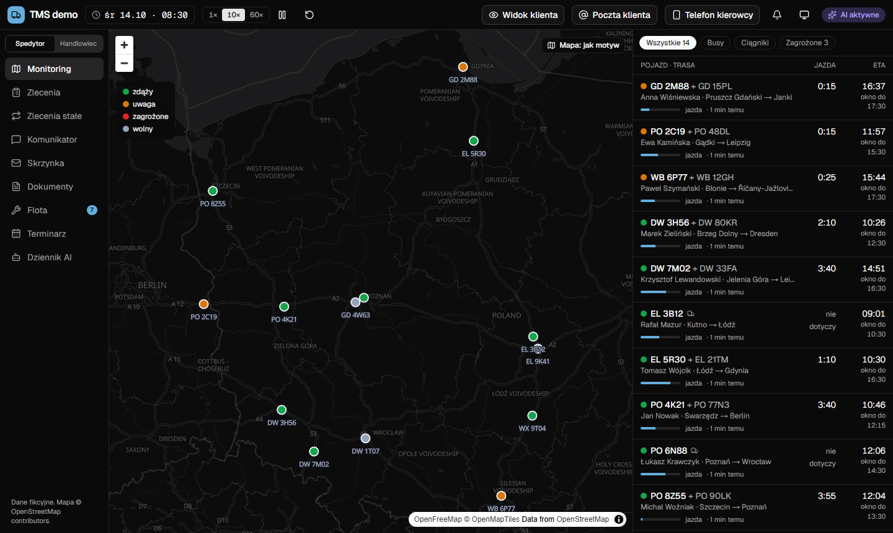
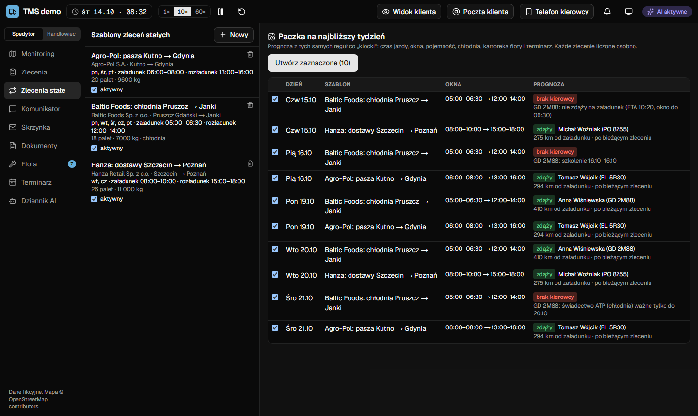
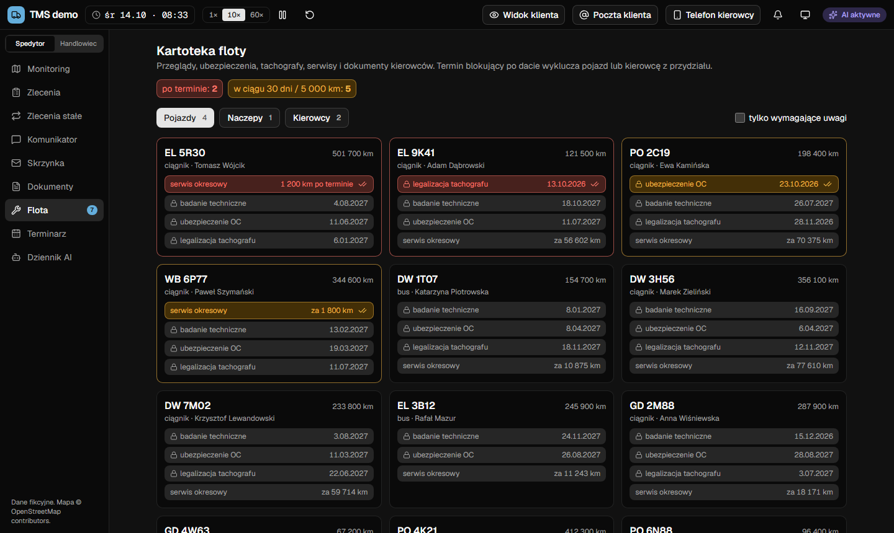
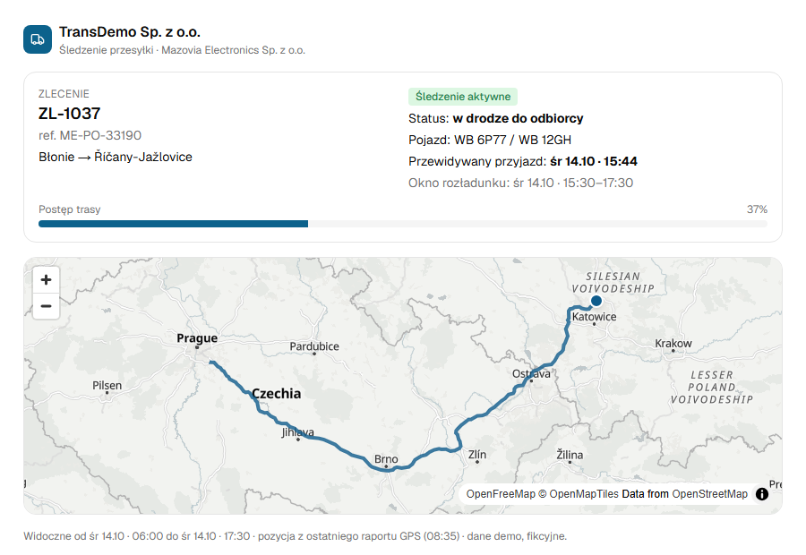
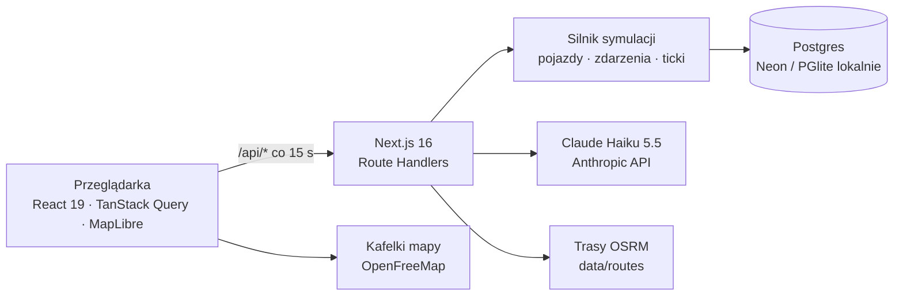

<div align="center">

# TMS z AI — demo

**System zarządzania transportem drogowym z monitoringiem floty i asystentem AI dla spedytora**

[](#status-i-plan)
[](LICENSE)


**[▶ Otwórz demo na żywo](https://tms-ai-demo.vercel.app)** · [English summary](#english-summary)

</div>

> [!WARNING]
> **Work in progress.** Projekt jest w trakcie prac. Funkcje mają testy automatyczne, ale czekają na pełne testy użytkowe; wygląd, zachowanie i dane mogą się zmieniać. Wszystkie firmy, osoby, numery i dane są fikcyjne.



Demo pokazuje, jak mógłby wyglądać prosty TMS dla firmy z busami i ciągnikami z naczepami, w którym AI pracuje w tle: czyta wiadomości kierowców i klientów, odczytuje zdjęcia CMR, wyjaśnia alerty i przygotowuje szkice odpowiedzi. **Decyzje zawsze podejmuje człowiek.** Każdy odwiedzający dostaje własny, fikcyjny świat z flotą w ruchu, w którym można bezpiecznie klikać wszystko.

## Funkcje

| Moduł | Co robi |
|---|---|
| **Monitoring** | Mapa 14 pojazdów, ETA z czasem pracy kierowcy według rozporządzenia 561/2006 (przerwy, odpoczynki), alerty o ryzyku spóźnienia, objazdy przy utrudnieniach. |
| **Zlecenia i „klocki”** | Dopasowanie kierowcy do zlecenia z powodami (dojazd, okna czasowe, pojemność, chłodnia, ADR, terminy, nieobecności), przydział przeciągnięciem, SMS do kierowcy, komunikator; „Zadzwoń” z alertu lub komunikatora zostawia notatkę z rozmowy w wątku kierowcy. |
| **Dokumenty CMR** | Zdjęcie z telefonu kierowcy, odczyt AI, dopasowanie do zlecenia, kolejki „do zamknięcia”, „weryfikacja”, „nieczytelne”. |
| **Skrzynka klientów** | Kategorie maili, szkice zleceń z zamówień i szkice odpowiedzi na pytania o status. |
| **Sprzedaż** | Wyceny drogowe ze stawek oraz zapytania do agentów (morski, lotniczy, kolejowy) bez ujawniania danych klienta; rola „Handlowiec”. |
| **Przesyłki morskie, lotnicze, kolejowe** | Plan etapów, automatyczne prośby o status do agentów (z przypomnieniem), odczyt odpowiedzi przez AI, alert przy zmianie ETA, przypomnienia o statusie dla klienta i szkic statusu z faktów (lub wysyłka automatyczna) bez danych agenta. Pozycji na żywo nie podłączono ze względu na koszty dostawców — zob. [`docs/sledzenie-przesylek.md`](docs/sledzenie-przesylek.md). |
| **Klienci i punkty** | Nowi klienci, osoby i punkty z mapą i wyszukiwaniem adresu (Nominatim); trasy do nowych punktów szacowane i oznaczone jako przybliżone. |
| **Panel klienta** | Link śledzenia jednego transportu: status, ETA, postęp i mapa, bez danych kierowcy. |
| **Flota i terminarz** | Terminy pojazdów, naczep i kierowców (badania, OC, tachograf, ATP, dokumenty) oraz nieobecności; terminy blokujące i nieobecności wykluczają z przydziału. Przepinanie naczep na placu z historią (która naczepa była pod którym ciągnikiem) i ostrzeżeniami o przydzielonych zleceniach. |
| **Zlecenia stałe** | Szablony i paczka zleceń na tydzień z prognozą terminowości, tworzona jednym kliknięciem; zwykły kierowca szablonu dostaje zlecenie, jeśli da radę, a SMS idzie dzień przed kursem o 16:00. Przy zagrożonym dniu „Doradź”: AI tłumaczy ryzyko z wyliczeń algorytmu i proponuje innego kierowcę albo co załatwić. |
| **Tryb ciemny** | Jak system / jasny / ciemny; mapa ma własny przełącznik jasna/ciemna. |

<table>
  <tr>
    <td width="50%"><br><sub>Monitoring w trybie ciemnym</sub></td>
    <td width="50%"><br><sub>Zlecenia stałe: paczka na tydzień z prognozą i powodem braku kierowcy</sub></td>
  </tr>
  <tr>
    <td width="50%"><br><sub>Kartoteka floty: terminy po terminie, wkrótce i blokujące</sub></td>
    <td width="50%"><br><sub>Strona śledzenia dla klienta, bez danych kierowcy</sub></td>
  </tr>
</table>

## Jak działa AI

- **„Algorytm liczy, AI rozmawia”.** Czasy jazdy, ETA, dopasowanie kierowców i ceny liczy deterministyczny kod. Model (Claude Haiku 5.5) czyta SMS-y kierowców, maile klientów i zdjęcia CMR, wyjaśnia alerty i szkicuje wiadomości.
- **Odpowiedzi w ustalonym schemacie** (walidacja Zod). Przy braku klucza, błędzie, przekroczonym limicie albo odmowie modelu działają reguły awaryjne — demo działa także bez klucza API.
- **Limity kosztów:** dzienny budżet dla całego demo i limit wywołań na świat i godzinę.
- **Dziennik AI:** każde wywołanie z wejściem, wynikiem, liczbą tokenów i kosztem; zmiany statusu wykonane przez AI można cofnąć.
- **Bezpieczniki prywatności:** widoki dla klienta nigdy nie zawierają danych kierowcy, a zapytania do agentów nie zawierają danych klienta (w razie wątpliwości wycena czeka na człowieka).
- **Ocena jakości:** `npm run eval:ai` sprawdza model na zestawach z wzorcowymi odpowiedziami (SMS-y, zdjęcia CMR, maile) i porównuje go z regułami awaryjnymi.

## Jak działa symulacja

- **Własny świat dla każdego odwiedzającego** (ciasteczko), z resetem i wygasaniem po 24 h.
- **Czas symulacji liczony z zegara** (tempo 1× / 10× / 60×, pauza). Zdarzenia są przetwarzane przy kolejnych odświeżeniach, więc całość działa na serverless.
- **Scenariusz:** 14 pojazdów, 11 naczep, 14 kierowców, 8 klientów, 24 punkty w Polsce, Niemczech i Czechach, 553 trasy policzone wcześniej przez OSRM, 15 agentów (morskich, lotniczych, kolejowych) i 4 przesyłki w drodze z różnymi kłopotami.
- **Nic nie wychodzi na zewnątrz:** „Telefon kierowcy” i „Poczta klienta” to symulatory; demo nie wysyła prawdziwych SMS-ów ani maili.

## Architektura



| Warstwa | Technologie |
|---|---|
| Interfejs | Next.js 16 (App Router, Cache Components), React 19, TypeScript (strict), Tailwind CSS 4, shadcn/ui, TanStack Query, MapLibre GL |
| Serwer | Next.js Route Handlers, Drizzle ORM, Zod |
| Baza danych | Postgres: Neon na produkcji, PGlite (wbudowany Postgres) lokalnie |
| AI | Anthropic SDK, Claude Haiku 5.5 (opcjonalnie Sonnet 5.5 do zdjęć CMR) |
| Mapy i trasy | OpenFreeMap (kafelki), OSRM (trasy policzone wcześniej, dane OpenStreetMap) |
| Testy | Vitest (logika, baza, API), Playwright (przepływy w przeglądarce) |
| Hosting | Vercel (funkcje we Frankfurcie) + Neon (eu-central-1) |

## Uruchomienie lokalne

Wymagania: **Node.js 24**. Docker nie jest potrzebny.

```bash
npm install
npm run dev
```

Otwórz <http://localhost:3000>. Lokalnie aplikacja używa wbudowanej bazy Postgres (PGlite) w katalogu `.pglite/` — nic nie trzeba instalować ani konfigurować.

**Klucz API (opcjonalnie).** Skopiuj `.env.example` do `.env.local` i wpisz klucz z [console.anthropic.com](https://console.anthropic.com):

```
ANTHROPIC_API_KEY=sk-ant-...
```

Bez klucza AI działa w trybie awaryjnym (proste reguły) i demo nadal działa. Z kluczem warto raz uruchomić `npm run eval:ai` (ok. 2 minuty, koszt rzędu centów).

## Testy

```bash
npm test               # Vitest: logika, baza (PGlite), API
npm run test:e2e       # Playwright: przepływy w przeglądarce
npm run lint && npm run typecheck
```

Testy e2e uruchamiają serwer w trybie reguł awaryjnych (bez klucza AI), żeby nie zależały od modelu ani od sieci. Jakość AI mierzy osobno `npm run eval:ai`.

## Wdrożenie na Vercel

1. Zaimportuj repozytorium w Vercel (**Add New → Project**). Next.js zostanie wykryty automatycznie.
2. Podłącz bazę: **Storage → Create Database → Neon**, połącz ją z projektem — integracja ustawi `DATABASE_URL`.
3. Ustaw zmienne w **Settings → Environment Variables**: co najmniej `ANTHROPIC_API_KEY`, `SANDBOX_IP_SALT` i `APP_URL` (zob. [Konfiguracja](#konfiguracja)).
4. **Deploy.** Polecenie budowania z `vercel.json` (`npm run db:migrate && npm run build`) samo tworzy i aktualizuje tabele w bazie.

`vercel.json` ustawia region funkcji na Frankfurt (`fra1`), obok bazy Neon w `eu-central-1`. Jeśli baza jest w innym regionie, zmień `regions` na najbliższy — inaczej każde zapytanie do bazy przelatuje między kontynentami. Bez `DATABASE_URL` aplikacja na Vercelu zatrzyma się z czytelnym komunikatem.

## Konfiguracja

Wszystkie zmienne są opcjonalne lokalnie; wzór jest w [`.env.example`](.env.example).

| Zmienna | Opis | Domyślnie |
|---|---|---|
| `DATABASE_URL` | Postgres (Neon); puste = lokalny PGlite | — |
| `ANTHROPIC_API_KEY` | Klucz API; bez niego tryb awaryjny | — |
| `AI_DAILY_BUDGET_USD` | Dzienny limit kosztu AI dla całego demo | `2` |
| `AI_CALLS_PER_SANDBOX_PER_HOUR` | Limit wywołań AI na świat i godzinę | `60` |
| `AI_CMR_MODEL` | Model do zdjęć CMR | Haiku 5.5 |
| `APP_URL` | Publiczny adres aplikacji (linki śledzenia w szkicach maili) | `http://localhost:3000` |
| `DEMO_PASSWORD` | Hasło do całego demo (link śledzenia dla klienta działa bez hasła) | brak |
| `NEXT_PUBLIC_MAP_STYLE_URL` | Styl jasnej mapy | OpenFreeMap Positron |
| `NEXT_PUBLIC_MAP_STYLE_DARK_URL` | Styl ciemnej mapy | OpenFreeMap Dark |
| `NEXT_PUBLIC_MAP_STYLE_FALLBACK_URL` | Zapasowy styl mapy | brak |
| `SIM_DEFAULT_SPEED` | Tempo symulacji na start | `10` |
| `SANDBOX_TTL_HOURS` | Czas życia świata demo | `24` |
| `SANDBOXES_PER_IP_PER_DAY` | Limit nowych światów na adres IP dziennie | `20` |
| `SANDBOX_IP_SALT` | Sól do skrótu adresów IP (na produkcji ustaw długą losową wartość) | wartość wbudowana |

## Struktura repozytorium

```
src/app/          strony i API (Next.js App Router)
src/components/   interfejs: moduły, mapa, motyw
src/domain/       czysta logika: dopasowanie, ryzyko, terminy, zlecenia stałe
src/simulation/   symulacja pojazdów i scenariusz demo
src/server/       logika serwera: ticki, zlecenia, skrzynka, sprzedaż, flota, przesyłki
src/ai/           wywołania AI, schematy odpowiedzi, reguły awaryjne
drizzle/          migracje bazy danych
data/routes/      trasy policzone przez OSRM (ODbL)
e2e/              testy Playwright
docs/             specyfikacje, plany, raporty i dokument wdrożeniowy
scripts/          migracje, ocena AI, generatory danych
```

## Status i plan

**Gotowe** (testy automatyczne, przed pełnymi testami użytkowymi):

- monitoring floty z czasem pracy kierowców i alertami,
- zlecenia z dopasowaniem kierowców, SMS-y i komunikator,
- dokumenty CMR z odczytem AI, skrzynka klientów,
- sprzedaż (wyceny drogowe i przez agentów), panel klienta,
- kartoteka floty i terminarz, zlecenia stałe,
- klienci i punkty z mapą (trasy do nowych punktów szacowane),
- przesyłki morskie, lotnicze i kolejowe ze statusami od agentów,
- tryb ciemny, wdrożenie na Vercel + Neon.

**Następne kroki:**

- pełne testy użytkowe i poprawki po nich,
- dokładne trasy do nowych punktów — wymaga liczenia tras w locie (decyzja o dostawcy tras),
- śledzenie przesyłek na żywo (AIS, trackery lotów, API armatorów) — niewdrożone w demo ze względu na koszty dostawców; sposób podłączenia opisuje [`docs/sledzenie-przesylek.md`](docs/sledzenie-przesylek.md),
- integracje produkcyjne: telematyka GPS, bramka SMS/MMS, poczta firmowa, system ERP — opisane w dokumencie wdrożeniowym w `docs/wdrozenie/`.

## Licencje

- Kod: **MIT** — zob. [`LICENSE`](LICENSE).
- Trasy w `data/routes/`: dane © OpenStreetMap contributors, **ODbL**; trasy policzone przez OSRM — zob. [`data/routes/LICENSE`](data/routes/LICENSE).
- Kafelki mapy: OpenFreeMap, © OpenMapTiles, dane © OpenStreetMap contributors.

Firmy, osoby, numery telefonów i rejestracyjne są zmyślone. Demo nie wysyła prawdziwych SMS-ów ani maili.

---

## English summary

**TMS with AI — demo.** A simple road-transport management system (vans and tractor-trailers) with live fleet monitoring and an AI assistant (Claude Haiku 5.5) working in the background for the dispatcher: it reads driver texts and customer e-mails, reads CMR photos, explains alerts and drafts replies. **A human always makes the decisions.** Every visitor gets their own fictional world with a moving fleet. The UI is in Polish.

> **Work in progress:** features are covered by automated tests but still await full user testing; things may change.

- **Live demo:** <https://tms-ai-demo.vercel.app>
- **Sea/air/rail shipments:** the system asks partner agents for status on a schedule, AI reads their replies (new ETA, delay reason) and drafts client updates from confirmed facts only. Live positions (AIS, flight trackers) are deliberately not connected — the providers are paid and the demo is self-funded; see `docs/sledzenie-przesylek.md` (Polish) for how to plug them in.
- **Principle:** deterministic code computes (driving times under EU Regulation 561/2006, ETAs, driver matching, prices); the model only reads, explains and drafts, always schema-validated, with rule-based fallbacks and cost limits.
- **Stack:** Next.js 16, React 19, TypeScript, Tailwind CSS 4, Drizzle ORM, Postgres (Neon / PGlite), MapLibre + OpenFreeMap, Anthropic SDK, Vitest, Playwright; hosted on Vercel + Neon.
- **Run locally:** `npm install && npm run dev` (Node.js 24; no database setup needed, an optional `ANTHROPIC_API_KEY` goes in `.env.local`).
- **License:** MIT. Route data © OpenStreetMap contributors (ODbL). All data is fictional.
